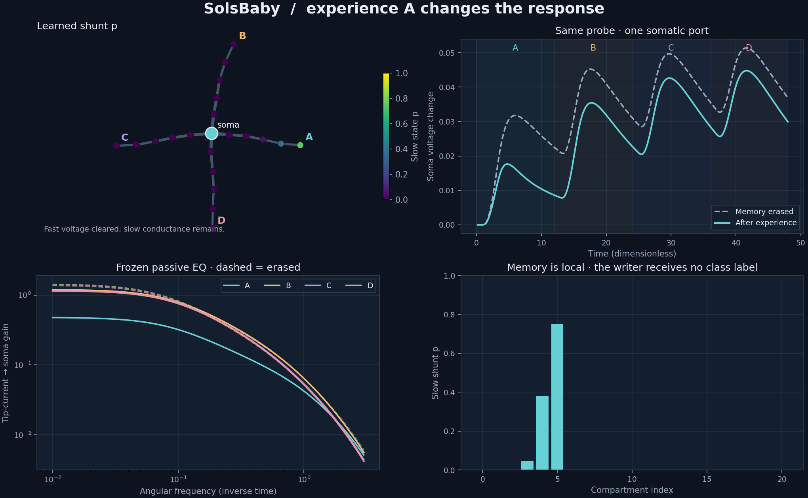

# SolsBaby

**Experience changes conductance. Conductance changes what the next signal becomes.**

A small, inspectable dendritic medium, built from the Sihti / VMN discussion.
It generates an electrical tree from a compact recipe, lets local activity
write a slow shunt, and asks whether a later probe can read that experience
from **one soma** after the original voltage has been cleared.



## Run it

Python 3.10 or newer. No GPU, model downloads, or training service.
From the repository directory:

```sh
python -m pip install -e .
python SolsBaby.py
```

On Windows, `py` can replace `python`. The desktop demo needs Tkinter,
normally included with the standard Windows Python installer. On Linux,
install your distribution's Python Tk package if necessary.

In the GUI:

1. Click **Experience A**. Watch the voltage travel, then disappear.
2. Click **Probe & compare**. The same branch-sweep probe produces a changed
   soma trace because a slow conductance state remains.
3. **Clear voltage** preserves that learned EQ. **Erase learned EQ** removes it.
4. Teach another branch to accumulate local changes; try a quick pulse with
   writing disabled, or toggle the illustrative active voltage boost.

The four panels show the tree, somatic response, frozen passive frequency
response, and local slow state. “Regrow” changes the developmental seed and
resets memory. Probe comparisons use copied states and freeze writing while
allowing slow decay; they are a controlled measurement intervention.

For a display-free walkthrough and the benchmark:

```sh
python -m solsbaby demo --out runs/demo
python -m solsbaby demo --active --branch 2 --out runs/active
python -m solsbaby benchmark --out runs/v1 --fail-on-gate
python -m unittest discover -s tests -v
```

The benchmark writes `results.json`, `protocol.json`, `episodes.csv`, and
`report.png`. A research gate failure is recorded in the report; add
`--fail-on-gate` when a nonzero exit status is desired. CLI overrides such as
`--noise-std 0.001` change the recorded protocol fingerprint.

## First registered result

The [v1 protocol](protocols/v1.json) was committed before the first held-out
run. Four morphology/episode seeds; 128 training and 128 independent test
episodes per seed; four familiar branch contexts; one somatic port sampled
80 times. The current probe is identical for every context. Observation
noise is added before the reader, and preprocessing is fitted on training
episodes only.

| Reader / intervention | Mean held-out accuracy |
|---|---:|
| Learned conductance, soma only | **100.0%** |
| Writer frozen throughout experience | 25.0% |
| Slow memory erased before measurement | 21.1% |
| Training labels shuffled once per seed | 29.5% |
| Full clean slow-state oracle | 100.0% |
| Chance | 25.0% |

The declared accuracy/control gate passed. All four learned-soma seeds
scored 100%. [Raw measurements](results/v1/results.json) include individual
seed results and predictions; [episode rows](results/v1/episodes.csv) and
the [plotted report](results/v1/report.png) are included.

The one-shuffle diagnostic ranges from 14.1% to 45.3% across seeds: with
only four latent contexts, a single random relabeling is a noisy null, not
a significance test. The frozen and erased controls are the registered
controls. The oracle has direct, noiseless access to every slow variable;
it is an observability sanity check, not a matched readout.

**Scope:** this demonstrates an engineered four-context memory mechanism.
There are 21 slow float64 tags (168 bytes); the task label needs only two
bits. It establishes no storage advantage, biological validation, broad
generalization, or advantage over transformers. Held-out episodes vary
pulse amplitude, timing, and observation noise; they are new examples of
the same four contexts. The main registered run has the active boost off.

## What is actually computing?

The developmental recipe generates cable lengths, diameters, capacitances,
leaks, and axial couplings. A tree solver advances the compartment voltages.
Local depolarization writes a bounded slow variable; this increases local
shunting and changes subsequent propagation. Labels never enter that writer.
In this model familiarity tends to **suppress** a branch's response.

The frequency panel computes the frozen **passive** tip-current-to-soma
transfer. Active voltage dependence is shown through simulated responses;
the passive panel does not pretend to describe its full nonlinear operator.
All units are dimensionless. The recipe is not literal DNA, and the active
term is not a calibrated receptor model.

See [the equations and controls](docs/MECHANISM.md),
[the design](docs/superpowers/specs/2026-10-17-solsbaby-design.md), and
[the implementation plan](docs/superpowers/plans/2026-10-17-solsbaby-plan.md).

## Research connections

- Wybo et al. (2013), [Green's functions bridge single- and multi-compartment models](https://arxiv.org/abs/1309.2382).
- Jordan et al. (2024), [Conductance-based dendrites perform Bayes-optimal cue integration](https://doi.org/10.1371/journal.pcbi.1012047).
- Barabási et al. (2023), [Complex computation from developmental priors](https://doi.org/10.1038/s41467-023-37980-1).
- Shuvaev et al. (2024), [Encoding innate ability through a genomic bottleneck](https://doi.org/10.1073/pnas.2409160121).

These motivate the questions. They do not validate this particular model.
Related projects: [Sihti](https://github.com/anttiluode/Sihti),
[VMN](https://github.com/anttiluode/VMN), and
[Operaattori](https://github.com/anttiluode/Operaattori).

MIT license.
